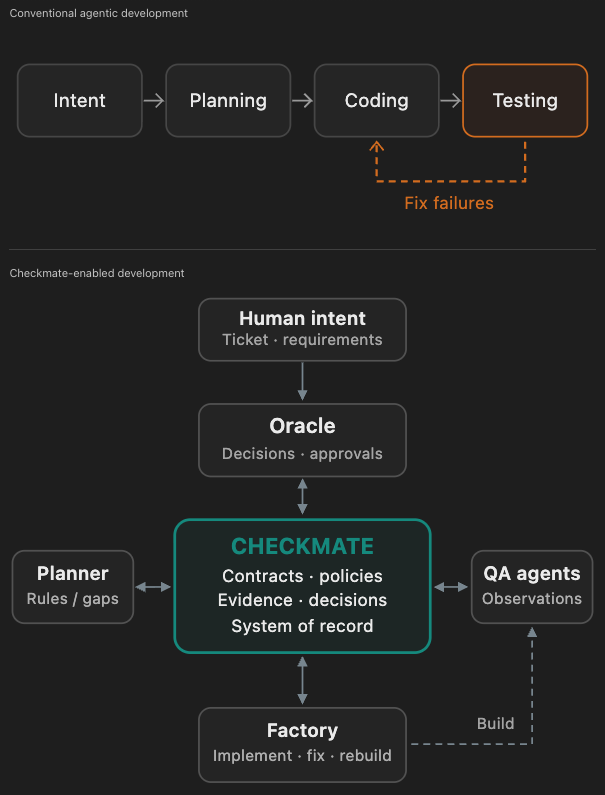
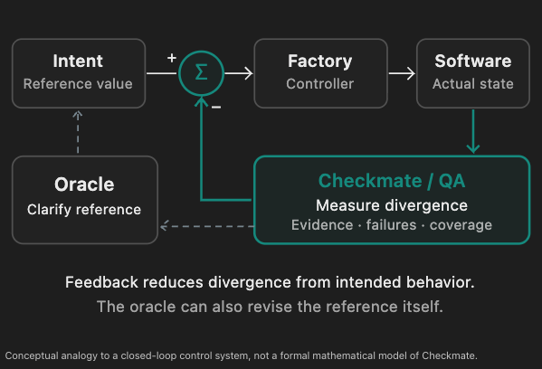

#### □ □ ■ □

# Checkmate

### The QA system of record for an agent software factory.

[](https://www.npmjs.com/package/@xoxoai/checkmate)

Checkmate turns a ticket into tests that an agent can run. It records the open questions, guides each test run, and keeps the evidence and every decision in one database. Agents and people read and write that record.

[](docs/img/onboarding.gif)

The Human review UI shows what waits for you: the evidence, findings and gaps. You can also chat with your harness directly.

[](docs/media/ui/review.gif)

## In one minute

- The **planner** turns a ticket into rules, tests, and open gaps.
- The **oracle** answers gaps, approves plans, and accepts results. It is an agent or a person.
- **QA** tests each build. Code compares each check with its expected value.
- The **factory** builds the code and starts the app.
- Checkmate starts the planner and the testers through Claude Code or Pi. It does not change code or start the app.
- Everything is kept in one SQLite file: `.checkmate/checkmate.db`.

## Core Idea

This is work in progress. I'm just exploring how far my real enterprise agentic QA workflows could be generalized. The biggest challenge is keeping the setup simple and abstract enough without sacrificing potential.

QA sits at the center of the agentic dev lifecycle and indirectly drives each iteration through contracts, policies and a system of record, instead of being an afterthought at the end.



Early evidence shows that it helps the agentic loops to self-align better with true intent.



It is inspired by TDD/BDD concepts applied with a twist specific to the agentic era.


Front-loading QA like this has clear benefits:

- **Catches gaps and ambiguities early:** Defects and missing edge cases surface where agentic development is most critical, as the core idea becomes exponentially harder to adjust for agents with each commit.
- **Sharpens requirements, reduces friction:** Planned features often become simpler - or some even turn out to be redundant - keeping the intent that matters.
- **Lowers delivery costs:** Teams stay focused on real business needs and waste less time on late-stage or post-release fixes.

## Limitations

- **CLI sub-agents don't inherit host tools:** Explorers started by the CLI cannot access your host's integrations (such as a Jira MCP server). In the plugin, testers inherit the tools of your host session, including its integrations; only the clerk is limited to `Read` and `Write`. In the CLI, explorers only get the tools you explicitly pass via `--allow` and cannot ask for more.
- **Plan first, unless you accept the above limitations:** Because of those tool limits, start by running the **planner**. It runs directly in your host environment, so it can read Jira tickets and other external sources before handing tasks off to explorers and testers.

## Solo mode: Claude Code or Pi

You are the oracle. The plugin and the extension ship the CLI.

```text
/plugin marketplace add dawiddiwad/checkmate
/plugin install checkmate@checkmate
/checkmate:test the change in docs/checkout.md at http://127.0.0.1:4173
/checkmate:ui
```

In Pi, run `pi install npm:@xoxoai/checkmate -l`, then use `/checkmate <request>` and `/checkmate-ui`. See [Start Checkmate](docs/start.md#use-a-host-plugin).

## Team mode: the CLI in a factory or CI

```sh
npm i -g @xoxoai/checkmate
checkmate setup --url http://127.0.0.1:4173 --target shop \
  --data environment --policy "Each run gets fresh data."
checkmate plan open checkout --target shop@1 \
  --objective "Verify checkout totals." --source docs/checkout.md
checkmate delegate plan checkout --allow Read --allow Bash
checkmate status checkout
```

For pipelines, see [Exit codes](docs/factory.md#exit-codes-for-a-pipeline). Both modes need Node.js 24.12.0 or later, and Claude Code or Pi: [Requirements](docs/start.md#requirements).

## Documentation

| Topic                     | Read                                             |
| ------------------------- | ------------------------------------------------ |
| Install and a first test  | [Start Checkmate](docs/start.md)                 |
| Local QA as the oracle    | [Local QA with a human oracle](docs/local-qa.md) |
| Factories and CI          | [Use Checkmate from a factory](docs/factory.md)  |
| Commands, states, records | [CLI and record reference](docs/reference.md)    |
| Contributing              | [Develop Checkmate](docs/development.md)         |

## License

[MIT](LICENSE)
