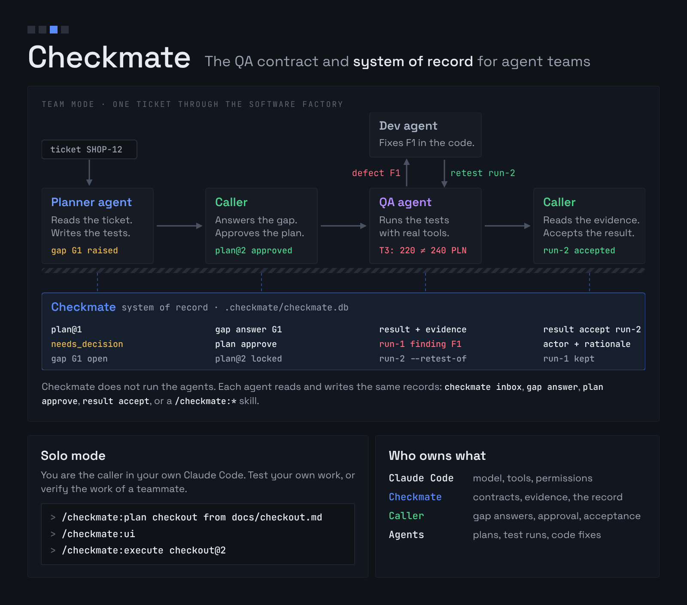
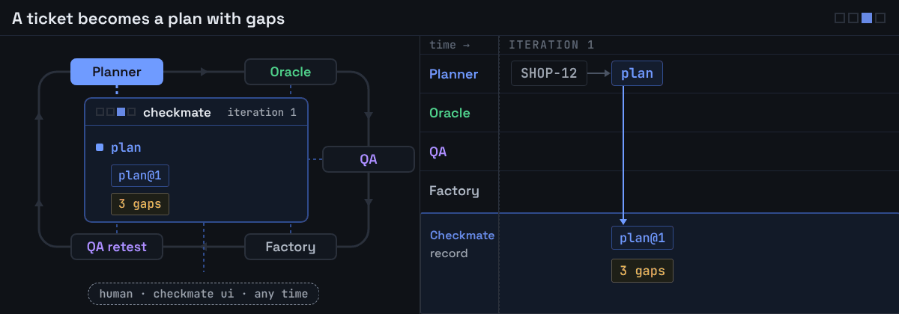

# Checkmate

Checkmate is a testing toolkit for Claude Code. It supplies workflows, contracts, execution checks, and evidence reports. Claude Code supplies the agent loop, model, tools, and permissions.

Use Checkmate to test requirements, changes, or a scoped exploratory objective. Source code is optional. Start with a running application and access to its tools.



## Install

Use Node.js 24.12.0 or later. TypeScript runs directly. No build step is required. The repository is a Claude plugin marketplace:

```text
/plugin marketplace add dawiddiwad/checkmate
/plugin install checkmate@checkmate
```

Install the plugin's Node.js dependencies before the first stage. For local development or PR review, clone this repository and run:

```sh
npm ci
claude --plugin-dir /absolute/path/to/checkmate
```

npm installs local dependencies. It does not distribute this plugin. The npm package stays at version `0.6.6`. New versions are GitHub releases.

For a production-only install in the plugin directory, use `npm ci --omit=dev`. Install Claude Code and Playwright CLI on the host separately. The tested versions are Claude Code `2.1.319` and Playwright CLI `0.1.23`.

The plugin has five skills:

- `/checkmate:setup`: check tools and save a target profile.
- `/checkmate:plan`: create tests and identify gaps.
- `/checkmate:revise`: apply caller decisions to a new plan revision.
- `/checkmate:execute`: run selected tests and save evidence.
- `/checkmate:report`: generate Markdown and HTML reports.

Give each skill an explicit request file. Use the schemas in [contracts](contracts) and the [CLI guide](docs/CLI.md).

## See the workflow

The animation shows an illustrative checkout example. It is not a recorded test session. Use the [static overview](docs/img/checkmate-infographic.png) or [poster](docs/img/onboarding-poster.png) to view a still image.



## Workflow

1. Set up the target profile. Record tools, versions, access references, and permitted operations.
2. Plan tests. Preserve each requirement and its source. Record unknown expected behavior as a blocking gap.
3. Ask the dispatching agent to clarify, accept an assumption, or defer coverage. Use a person when the agent lacks authority.
4. Revise the plan. Keep the prior revision unchanged.
5. Execute selected tests. The default policy blocks execution while an open blocking gap remains.
6. Read the result and its evidence. The caller decides whether to fix the application or release it.
7. Retest in a new run after a fix. Preserve earlier results and omitted coverage.

A completed run can contain defects. Complete coverage can contain failed tests. A process exit code is not a release decision.

## Run a delegated stage

```sh
node /absolute/path/to/checkmate/bin/checkmate.ts delegate requests/plan.json --workspace /path/to/project \
  --allow Read --allow Write --allow 'Bash(node *)'
```

The launcher starts one fresh Claude Code session. Select tool rules for the requested stage. A browser stage also needs permission for the applicable Playwright commands. Do not grant blanket permissions in an untrusted workspace.

Use a normal Claude login, `CLAUDE_CODE_OAUTH_TOKEN`, or `ANTHROPIC_API_KEY`. Keep credentials in the host's secret store. Checkmate does not extract tokens or implement authentication.

## Examples

These documents describe an illustrative local checkout. They are not evidence from a live application. Expand a section to read the complete JSON document.

File digests refer to the exact files in [docs/examples](docs/examples). A change to a referenced file requires a new digest.

<details>
<summary>Configuration: target profile</summary>

The profile records the target, tool versions, access references, and permitted operations.

```json
{
	"contractVersion": "toolkit-1",
	"targetId": "checkout-local",
	"revision": 1,
	"baseUrl": "http://127.0.0.1:4173",
	"environment": "local_fixture",
	"capabilities": ["browser", "http"],
	"tooling": [
		{
			"capability": "browser",
			"executable": "playwright-cli",
			"version": "0.1.23"
		},
		{
			"capability": "http",
			"executable": "node",
			"version": "v24.22.1"
		}
	],
	"authentication": {
		"kind": "none",
		"references": []
	},
	"allowedOperations": ["read_catalog", "create_fixture_order", "apply_fixture_discount"],
	"startup": {
		"owner": "caller",
		"command": null
	},
	"cleanup": "Close the run browser session. The fixture stores no records.",
	"readyForLiveExecution": true
}
```

</details>

<details>
<summary>Input: planning request</summary>

The request keeps each requirement and its source. Missing expected behavior must become a planning gap.

```json
{
	"contractVersion": "toolkit-1",
	"requestId": "req-plan-1",
	"operation": "plan",
	"caller": "factory-agent",
	"objective": "Verify checkout and identify missing acceptance decisions.",
	"target": {
		"path": "profile.json",
		"sha256": "d2c76c324a66b6fabf788ac059d556a62204edf68d0472f2c982e2368962da70"
	},
	"requirements": [
		{
			"id": "R1",
			"text": "A standard order for a 100 PLN item has a total of 100 PLN.",
			"source": "caller://checkout-brief#standard"
		},
		{
			"id": "R2",
			"text": "A 10 percent promotion is applied during checkout; stacking behaviour is unspecified.",
			"source": "caller://checkout-brief#promotion"
		},
		{
			"id": "R3",
			"text": "Refund behaviour must be checked; eligibility rules are unspecified.",
			"source": "caller://checkout-brief#refund"
		}
	],
	"sourceContext": [
		{
			"uri": "caller://checkout-brief",
			"content": "Fixture checkout sells one item at 100 PLN. Promotion is 10 percent. Existing loyalty reduction can be 5 PLN. Confirm stacking and refund eligibility before asserting them."
		}
	],
	"outputPlanId": "checkout",
	"planDirectory": "plans/checkout"
}
```

</details>

<details>
<summary>Input: caller decisions</summary>

The caller clarifies the discount rule and defers refund coverage. The next plan revision preserves these decisions.

```json
{
	"contractVersion": "toolkit-1",
	"requestId": "revise-1",
	"caller": "test-caller",
	"operation": "revise",
	"basePlan": {
		"path": "plans/checkout/v1.json",
		"sha256": "b03bbbf184594ed120e91b92efc45bd4382567e1d47a4fd03a907b266f9f27df"
	},
	"baseRevision": 1,
	"decisions": [
		{
			"id": "D1",
			"gapId": "G1",
			"kind": "clarify",
			"actor": "factory-agent",
			"rationale": "Product acceptance decision supplied by dispatcher.",
			"value": "Promotion replaces loyalty. Apply 10 percent to the undiscounted 100 PLN subtotal; expected total is 90 PLN.",
			"source": "caller://acceptance-decisions/checkout#promotion"
		},
		{
			"id": "D2",
			"gapId": "G2",
			"kind": "defer",
			"actor": "factory-agent",
			"rationale": "Refund policy is outside this delivery; preserve the uncovered requirement.",
			"value": "Do not execute refund checks in this scope.",
			"source": null
		}
	]
}
```

</details>

<details>
<summary>Input: execution request</summary>

The request selects two tests and pins the target and plan by digest. It uses the default execution policy.

```json
{
	"contractVersion": "toolkit-1",
	"requestId": "execute-1",
	"caller": "test-caller",
	"operation": "execute",
	"runId": "run-1",
	"plan": {
		"path": "plans/checkout/v2.json",
		"sha256": "ef15b530201bdc683341ecb0a704903d6e7eef2ab550f7df8fe3f98e7ad2c194"
	},
	"target": {
		"path": "profile.json",
		"sha256": "d2c76c324a66b6fabf788ac059d556a62204edf68d0472f2c982e2368962da70"
	},
	"selectedTestIds": ["T1", "T2"],
	"partialExecution": "wait_for_resolution",
	"timeoutSeconds": 180,
	"onNewBlocker": "return_to_caller",
	"applicationBuild": "fixture-build-1",
	"outputDirectory": "runs/run-1"
}
```

</details>

<details>
<summary>Output: execution result</summary>

The run completed. One test failed. Deferred refund coverage remains visible. Completion, test outcomes, and coverage are separate fields.

```json
{
	"contractVersion": "toolkit-1",
	"requestId": "execute-1",
	"runId": "run-1",
	"completion": "completed",
	"plan": {
		"path": "plans/checkout/v2.json",
		"sha256": "ef15b530201bdc683341ecb0a704903d6e7eef2ab550f7df8fe3f98e7ad2c194"
	},
	"target": {
		"path": "profile.json",
		"sha256": "d2c76c324a66b6fabf788ac059d556a62204edf68d0472f2c982e2368962da70"
	},
	"applicationBuild": "fixture-build-1",
	"selectedTestIds": ["T1", "T2"],
	"startedAt": "2026-11-07T14:24:25.788Z",
	"tests": [
		{
			"testId": "T1",
			"outcome": "passed",
			"expected": "The order total is 100 PLN.",
			"observed": "Order confirmed: 100 PLN",
			"assertionKind": "agent_observation",
			"evidenceIds": ["E-T1"],
			"reason": null
		},
		{
			"testId": "T2",
			"outcome": "failed",
			"expected": "HTTP 200 and totalPLN equals 90, with the loyalty discount replaced.",
			"observed": "HTTP 200; totalPLN = 85",
			"assertionKind": "deterministic",
			"evidenceIds": ["E-T2"],
			"reason": "Observed total differs from expected total."
		},
		{
			"testId": "T3",
			"outcome": "not_run",
			"expected": null,
			"observed": null,
			"assertionKind": null,
			"evidenceIds": [],
			"reason": "Test was not selected or was deferred."
		}
	],
	"findings": [
		{
			"id": "F1",
			"type": "defect",
			"severity": "medium",
			"testIds": ["T2"],
			"requirementIds": ["R2"],
			"title": "Promotion stacks with loyalty",
			"expected": "90 PLN",
			"observed": "85 PLN",
			"reproduction": [
				"Create a 100 PLN cart with 5 PLN loyalty.",
				"Apply a 10 percent promotion.",
				"Read the quote total."
			],
			"evidenceIds": ["E-T2"]
		}
	],
	"newGaps": [],
	"evidence": [
		{
			"id": "E-T1",
			"kind": "observation",
			"path": "evidence/T1.txt",
			"sha256": "fa3a45444d201a31e6e94f5e2f15120fd0518c893b533db779d6f17f4341ee60"
		},
		{
			"id": "E-T2",
			"kind": "observation",
			"path": "evidence/T2.txt",
			"sha256": "a7605959105b8b69cfc226cfb2192dd2ec682fbba7ec47597796a09acd2315b3"
		}
	],
	"cleanup": {
		"status": "not_applicable",
		"reason": "Illustrative document. No application was used to create this example."
	},
	"finishedAt": "2026-11-07T14:24:25.850Z",
	"coverage": {
		"status": "partial",
		"requirements": [
			{
				"requirementId": "R1",
				"status": "tested",
				"testIds": ["T1"],
				"reason": null
			},
			{
				"requirementId": "R2",
				"status": "tested",
				"testIds": ["T2"],
				"reason": null
			},
			{
				"requirementId": "R3",
				"status": "uncovered",
				"testIds": ["T3"],
				"reason": "At least one required check or decision is missing."
			}
		]
	}
}
```

</details>

Read the [first plan](docs/examples/plans/checkout/v1.md), [revised plan](docs/examples/plans/checkout/v2.md), and [Markdown report](docs/examples/runs/run-1/report.md). Open the [HTML report](docs/examples/runs/run-1/report.html) locally. The [evidence directory](docs/examples/runs/run-1/evidence) contains the referenced files.

## Read more

- [Contracts and configuration](docs/CONFIGURATION.md)
- [CLI and stage responses](docs/CLI.md)
- [Evidence and reports](docs/EVIDENCE.md)
- [Development and tests](docs/DEVELOPMENT.md)
- [Browser recipe](references/browser.md)
- [HTTP recipe](references/http.md)

## Scope

The scripts enforce Checkmate contract checks. They cannot restrict an agent that has arbitrary shell access. Tool permissions belong to the host. A valid file does not prove that an observation is accurate.

Checkmate does not fix product code, provision environments, generate maintained test suites, or publish releases. It does not enforce model token budgets or sanitize arbitrary screenshots.

## License

[MIT](LICENSE)
