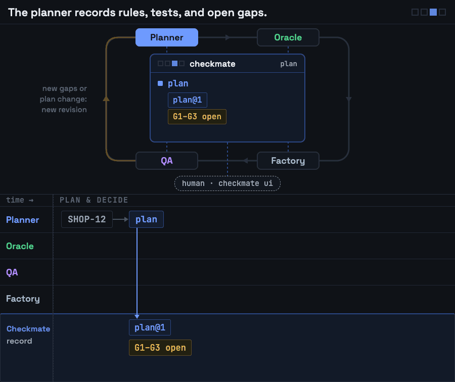

#### □ □ ■ □

# Checkmate

### The QA system of record for an agent software factory.

Checkmate turns a ticket into tests. It records each run, its evidence, open questions, and oracle decisions in one local SQLite record. Agents and people use the same record.



## Start in a project

Use Node.js 24.12.0 or later. Start the application you want to test, then install Checkmate and open its review UI:

```sh
npm install -g @xoxoai/checkmate
cd /path/to/your/project
checkmate ui
```

Open the URL that Checkmate prints. If no target exists, follow **Set up the application**; the new-change form opens after setup. Otherwise, choose **New change**. Enter a ticket or source file and start the test. Checkmate records the work in `.checkmate/checkmate.db` in this project.

For delegated planning or testing, configure Claude Code or Pi in the host. The host owns models, credentials, tools, and permissions. Checkmate does not start your application.

## Choose a path

- [Start and install](docs/start.md): prerequisites and first steps.
- [Local human-oracle QA](docs/local-qa.md): run a local ticket, answer questions, inspect evidence, and recover a stopped run.
- [Factory workflows](docs/factory.md): review before a build, build and promote tests, or run a permanent snapshot.
- [CLI and record reference](docs/reference.md): commands, contracts, statuses, evidence, and limits.
- [Development](docs/development.md): the installed-package gate and its prerequisites.

The planner defines tests. QA runs them on a named build. The oracle answers gaps, approves plans, and accepts recorded results. The factory builds and fixes the application.

## License

[MIT](LICENSE)
