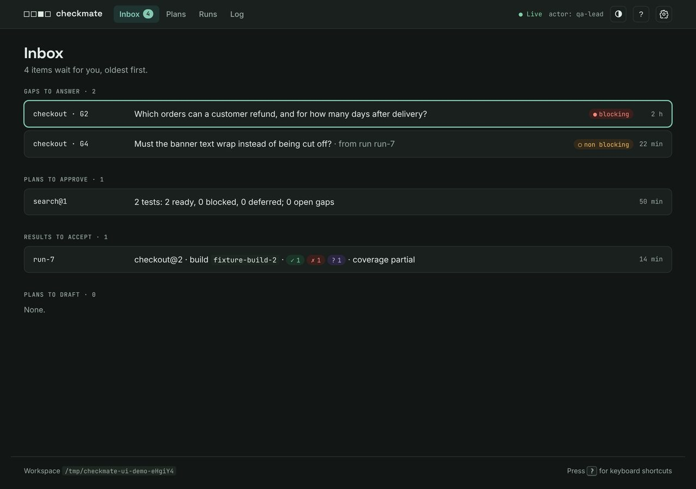
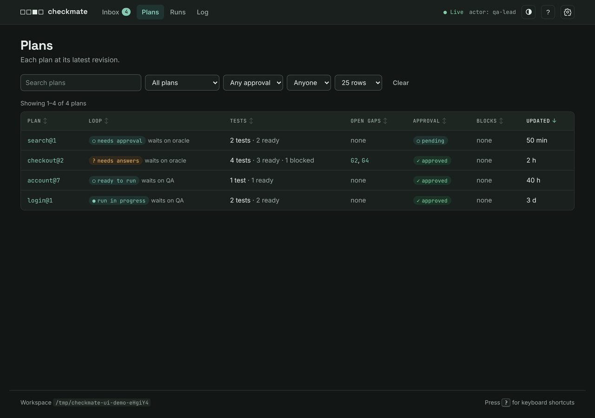
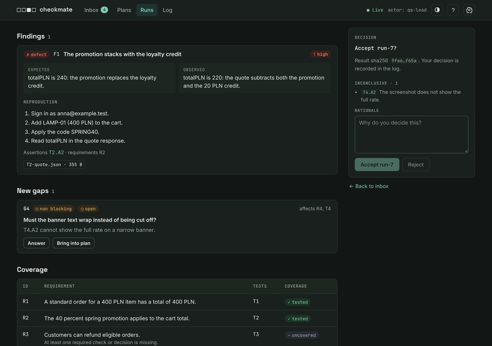
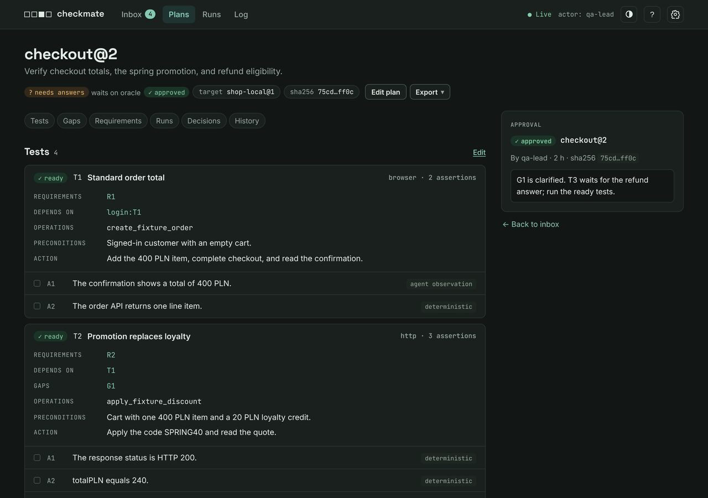
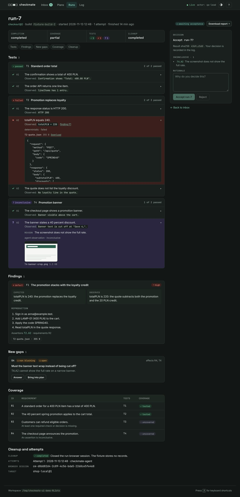

#### □ □ ■ □

# Checkmate

### The QA system of record for an agent software factory.

It turns a ticket into executable requirements, finds the gaps, drives test runs, and keeps the evidence and every decision in one auditable database. The factory runs the agents and builds the code. Checkmate keeps the record that they all read.


The **oracle** answers gaps, approves plans, and accepts results. It is a product-owner agent or a human.<br/>
Checkmate does not start, schedule, or message agents, and it does not change code. Your factory does.

## Actors

| Role    | What it does                                                    | What it writes to the record                |
| ------- | --------------------------------------------------------------- | ------------------------------------------- |
| Planner | Turns a ticket into tests. Records the gaps.                    | Plan revisions and gaps                     |
| Oracle  | Answers gaps. Approves plans. Accepts results.                  | Decisions                                   |
| QA      | Runs the tests, early and again on each new build.              | Runs, evidence, defects, and new gaps       |
| Factory | Runs the agents and their sandboxes. Builds and fixes the code. | Only what its commands record, such as runs |

A human can make the oracle's decisions at any time in the review UI.

## Highlights

- **Shared QA record.** Everything lives in `.checkmate/checkmate.db`. Payloads go through stdin, no temporary files.
- **Built for a factory.** `plan open` takes `--objective` and `--source`. Early runs pick the ready tests. Gaps found during a run go into the plan with `gap answer` or `plan adopt-gaps`. Small edits use `plan edit --patch`. A retest replaces the earlier run in the inbox.
- **The caller is the Oracle.** Policy `return_to_oracle`, startup owner `factory`, and the assertion field `checkKind`.
- **The review UI inside the plugin.** No npm install is needed for `/checkmate:ui`. Lists are paged, sorted, and filtered as you type. Plans can be edited, and reports download as HTML, Markdown, or JSON.
- **Aware of the caller's harness tools.** A target lists the CLI tools, MCP servers, and skills that the factory provides. Claude Code still owns the permissions.

## The review UI



<details>
<summary>More screenshots</summary>





</details>

## Team mode

### QA CLI for your Factory

Install the CLI with `npm i -g @xoxoai/checkmate@^0.7.0` and set up a target with `checkmate target open` and `checkmate delegate setup`. Then the factory opens a plan for each ticket, lets the planner write it, and reads what waits for the oracle:

```sh
checkmate plan open checkout --target shop@1 --objective "Verify checkout totals." --source docs/checkout.md
checkmate delegate plan checkout --allow Read --allow Bash
checkmate inbox
```

To give requirements or plan tools, send the request as JSON on standard input ([Plan request](docs/CONFIGURATION.md#plan-request)). `checkmate status checkout` says where the ticket is in the loop and who it waits on. Your factory can read the record with `status`, `inbox`, `log`, `query` (read-only), and `export --format json`. [The factory loop](docs/WORKFLOW.md#factory-loop) shows each step, from the early red run to acceptance.

## Solo mode

### Plugin for your Claude Code

You are the oracle. Test your own work, or verify the work of a teammate. Install the plugin with `/plugin marketplace add dawiddiwad/checkmate` and `/plugin install checkmate@checkmate`. It does not need the npm CLI.

```text
/checkmate:setup shop at http://127.0.0.1:4173, browser, operations read_catalog and create_order
/checkmate:plan checkout for shop@1: verify checkout totals from docs/checkout.md
/checkmate:ui
/checkmate:status checkout
```

[The full path in Claude Code](docs/WORKFLOW.md#in-claude-code): setup, plan, review, revise, execute, and report.

Both modes need Claude Code and Node.js 24.12.0 or later. Team mode also needs a logged-in `claude` command. For browser tests, install Playwright CLI: `npm i -g @playwright/cli`.

## Docs

- [Workflow](docs/WORKFLOW.md): each stage and decision, the factory loop, and sub-agents
- [CLI](docs/CLI.md): commands, statuses, delegated stages, and the review UI
- [Configuration](docs/CONFIGURATION.md): targets, plans, policies, runtime gaps, and the actor
- [Evidence and outcomes](docs/EVIDENCE.md): assertions, evidence, outcomes, coverage, and reports
- [Validation](docs/VALIDATION.md): what the tests and the live run check
- [Examples](docs/examples/README.md): plans and runs exported from a live run
- [Development](docs/DEVELOPMENT.md): build, test, release, and the media of this page

## License

[MIT](LICENSE)
