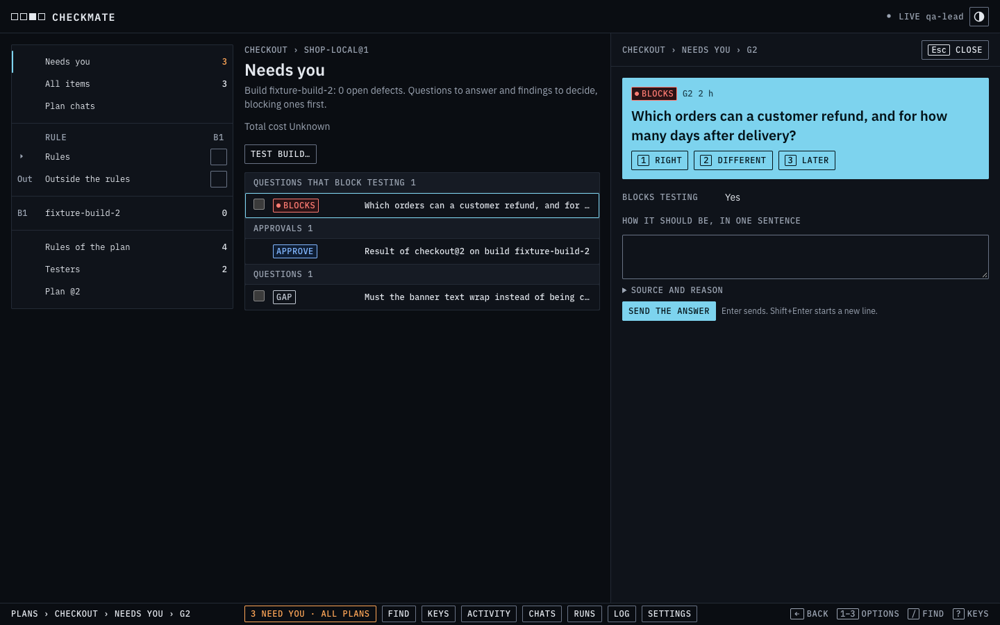

#### □ □ ■ □

# Checkmate

### The QA system of record for an agent software factory.

Checkmate turns a ticket into tests. It records each run, its evidence, open questions, and oracle decisions in one local SQLite record. Agents and people use the same record.

[![The QA loop on ticket SHOP-12: QA explores build b1 and finds 3 gaps and 2 defects. The oracle answers, the planner saves plan@2, and QA follows up. The oracle hands the defects to the factory. Build b2 has 1 defect and 2 new gaps; the oracle escalates the gaps to a human, the planner saves plan@3, and the factory delivers build b3. QA finds nothing new, the oracle accepts and promotes the tests, and a permanent run confirms them. Then three ways to run Checkmate: a solo developer with the Claude Code plugin or the Pi extension, a software factory that calls one command per stage and waits on exit 3, and a CI job that runs the promoted tests and fails on the gate.](docs/img/onboarding.gif)](docs/img/onboarding.gif)

The review UI shows what waits for you, here a blocking question that you answer in the drawer before QA continues.

[](docs/media/ui/review.png)

## Start in a project

Use Node.js 24.12.0 or later. Start the application you want to test. Then install Checkmate in its project and open the review UI:

```sh
npm install --save-dev @xoxoai/checkmate
npx checkmate ui
```

Open the printed URL. Set up the application if Checkmate asks, then choose **New change**. [Start Checkmate](docs/start.md) gives the requirements, the data kinds, and the host setup.

## Parts of Checkmate

Local workflows and factory workflows can both go through the Claude Code plugin or the Pi extension. Both ship the CLI, so many uses need no separate CLI install.

**Claude Code plugin.** Run `/plugin marketplace add dawiddiwad/checkmate` and `/plugin install checkmate@checkmate`, then `/checkmate:test`. See [Use a host plugin](docs/start.md#use-a-host-plugin).

**Pi extension.** Run `pi install npm:@xoxoai/checkmate -l`, then `/checkmate <ticket>` or `/checkmate-ui`. See [Use a host plugin](docs/start.md#use-a-host-plugin).

**CLI.** Run `npm install --save-dev @xoxoai/checkmate`, then `npx checkmate --help`. Use the CLI on its own in the CI/CD workflows of a factory that does not use Claude Code or Pi and has its own harness. See [Factory workflows](docs/factory.md).

More: [Local QA](docs/local-qa.md) · [CLI and record reference](docs/reference.md) · [Develop Checkmate](docs/development.md)

## License

[MIT](LICENSE)
