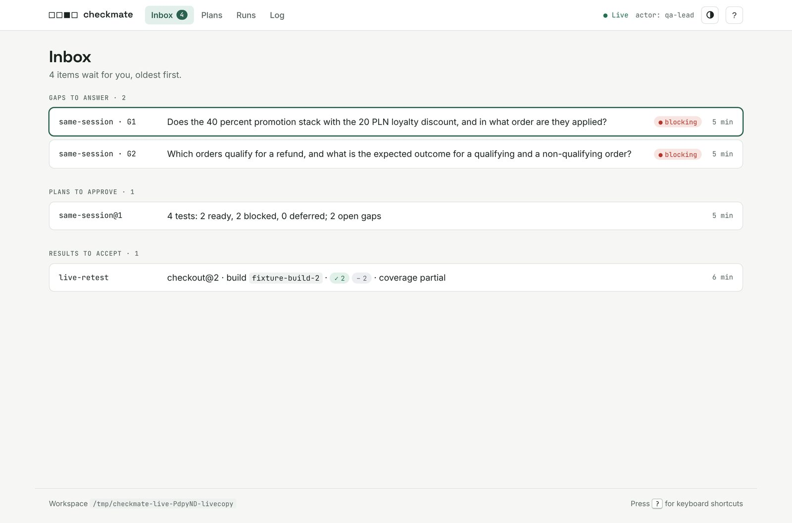
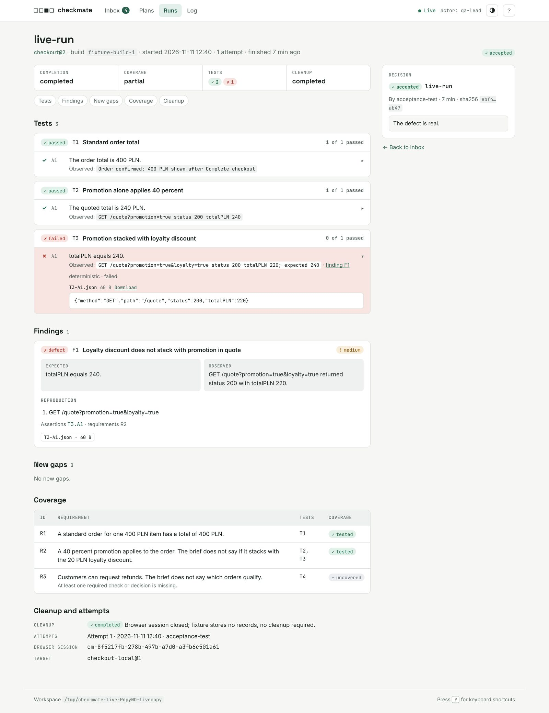

# Workflow

Checkmate has five stages: setup, plan, revise, execute, and report. Between the stages, the oracle makes decisions.

Checkmate has two modes. In team mode, agents share the QA work, and a product-owner agent or a person is the oracle. Read [From an agent or a script](#from-an-agent-or-a-script), [Factory loop](#factory-loop), and [Sub-agents in Claude Code](#sub-agents-in-claude-code). In solo mode, you are the oracle in your own Claude Code. Read [In Claude Code](#in-claude-code).

- The **oracle** answers gaps, approves plans, and accepts results. The oracle is anyone who can give the answer: a product-owner agent or a person.
- The **actor** is the name that Checkmate records with each write. Commands use `--actor`, then `CHECKMATE_ACTOR`, then `git config user.name`, then the login name. `delegate` records its workers as `claude:<stage>`.
- The **host** is Claude Code. It owns the model, authentication, tools, and permissions.

All state is in `.checkmate/checkmate.db` in the application workspace. Run the commands and the skills in that workspace.

## In Claude Code

Use this path when you work in Claude Code with the plugin. You do not need the npm CLI. [README](../README.md#solo-mode-your-claude-code) shows how to install the plugin.

1. Set up the target. Give the base URL, the capabilities, and the operations that tests can do. You can name tools, for example an MCP server:

   ```text
   /checkmate:setup checkout-local at http://127.0.0.1:4173, capabilities browser and http,
   operations read_catalog, create_fixture_order, apply_fixture_discount
   ```

   Claude records the request, checks each tool and the target, and saves profile `checkout-local@1`.

2. Plan. Give the objective and the requirements, or the sources to read:

   ```text
   /checkmate:plan checkout for checkout-local@1. Objective: verify checkout totals. Source: docs/checkout.md
   ```

   Claude writes revision 1. Each unclear requirement becomes an open blocking gap, for example `G1: Does the 40 percent promotion stack with the 20 PLN loyalty discount?`

3. Open the review UI:

   ```text
   /checkmate:ui
   ```

   Open the URL that Claude shows. Answer the gaps in the UI. The UI records your name with each decision: click `actor: <name>` in the header to change it. You can also tell Claude the answer, for example "Answer G1: the promotion replaces the loyalty discount. The total is 240 PLN. Source: product decision."

4. Apply the decisions:

   ```text
   /checkmate:revise checkout
   ```

   Claude writes revision 2. Read it in the UI. To change it, click `Edit plan`. Then approve it.

5. Execute:

   ```text
   /checkmate:execute checkout@2, tests T1,T2,T3, build fixture-build-1, run ID run-1
   ```

   Claude checks the gate, begins the run, records each assertion with evidence, closes each test, records findings, and finishes the run.

6. Accept or reject the result on the run page of the UI.

7. Get the report. On the run page, click `Download report` and select HTML, Markdown, or JSON. Or ask Claude:

   ```text
   /checkmate:report run-1 as html in reports/run-1.html
   ```

After each stage, Claude reports in one format: a Markdown table of the plans, tests, gaps, or runs; a `Done:` line; and a `Next:` line with the decision, who makes it, and the command or UI action. Before Claude answers a question about the state, it reads the database with `inbox`, `plan list`, `plan show`, `run list`, or `run show`.

<details>
<summary>Screenshots of the review UI</summary>

From a live run on a local checkout fixture. Claude found the seeded defect: the quote total is 220 PLN, and the requirement expects 240 PLN. The plans and runs of that live run are in [examples](examples/README.md).




</details>

## From an agent or a script

Use the npm CLI, version 0.7.0 or later (`npm i -g @xoxoai/checkmate@^0.7.0`), when an agent, a CI job, or a script gives QA work to Checkmate. The agent opens each subject and delegates the stage. The oracle makes the decisions. One agent can do both. `delegate` needs the `claude` command, installed and logged in.

Read line 1 of each response: `<status> <subject>`. `completed` and `needs_decision` exit with 0. `needs_decision` means that the oracle must decide or give input, for example for open gaps or a refused gate. Read the `reason:` lines. [CLI](CLI.md#output-and-exit-codes) lists every status.

Give each delegated stage at least `--allow Read --allow Bash`. A prefix rule such as `Bash(node *)` is not sufficient: the permission check of Claude Code blocks the heredoc that sends a JSON payload. [CLI](CLI.md#delegated-stages) has the details. The host owns the permissions.

Set up the target with its tools: `--tool <name>:<cli|mcp|skill>:<purpose>`. When no tool is named for a capability, the setup stage adds `playwright-cli` for `browser` and `node` for `http`. This example reads the requirements from a Jira ticket through the `jira` MCP server of the host:

```sh
checkmate target open checkout-local --base-url "$BASE_URL" --capabilities browser,http \
  --operations read_catalog,create_fixture_order,apply_fixture_discount \
  --tool "playwright-cli:cli:Drive the browser." --tool "jira:mcp:Read the acceptance criteria."
checkmate delegate setup checkout-local --allow Read --allow Bash
```

Open the plan with its sources and instructions, then delegate the plan stage. Allow the tools that read the sources. `mcp__jira` allows every tool of the `jira` server. The worker uses the MCP servers of the host configuration:

```sh
checkmate plan open checkout --target checkout-local@1 <<'EOF'
{
  "objective": "Verify checkout totals and identify missing acceptance decisions.",
  "context": { "sources": ["jira:SHOP-12"], "instructions": "Use the acceptance criteria only." }
}
EOF
checkmate delegate plan checkout --allow Read --allow Bash --allow mcp__jira
```

A plan with gaps gives `needs_decision` with one `reason:` line for each open blocking gap. This is a correct result.

Then read what waits for a decision, and decide:

```sh
checkmate inbox
checkmate gap answer checkout G1 --kind clarify --source decisions#promotion \
  --value "The promotion replaces the loyalty discount. The quote total is 240 PLN." \
  --rationale "Product owner decision."
checkmate gap answer checkout G2 --kind defer \
  --value "Refunds are out of scope for this release." --rationale "Product owner decision."
checkmate delegate revise checkout --allow Read --allow Bash
checkmate plan show checkout@2
checkmate plan approve checkout@2 --rationale "Tests and assertions match the brief."
```

Execute, then accept or reject the result:

```sh
checkmate run begin run-1 checkout@2 --tests T1,T2,T3 --build "$GIT_SHA"
checkmate delegate execute run-1 --allow Read --allow Bash
checkmate run show run-1
checkmate result accept run-1 --rationale "The defect in T3 is real. Fix before release."
checkmate export run run-1 --format html --out reports/run-1.html
```

- When `run begin` prints `needs_decision`, the gate refused the run, and no run exists. The `reason:` lines name the missing approval, the open gaps, or the blocked tests.
- `delegate` does not trust the worker's summary. It reads the database and returns the response of the recorded command. Read [CLI](CLI.md#delegated-stages) for the permissions and deadlines.
- Without `--out`, `export` prints the report on standard output.

## Factory loop

In a QA-driven software factory, agents do acceptance-test-driven development. The factory runs the agents and their sandboxes, the harness, the builds, and the code changes. Checkmate drives the definition of executable requirements, gap discovery, test execution, and evidence capture through its stages, and keeps the results as an auditable record. Claude Code runs the tools. Checkmate does not start, schedule, or message agents, and it does not change code. The agents coordinate through the records.

| Role          | What it does                                                                | Checkmate interface                                                                                                                                                                       |
| ------------- | --------------------------------------------------------------------------- | ----------------------------------------------------------------------------------------------------------------------------------------------------------------------------------------- |
| Planner agent | Runs the plan and revise stages. Turns the ticket into tests. Records gaps. | `delegate plan`, `delegate revise`, or a sub-agent with `/checkmate:plan`, `/checkmate:revise`                                                                                            |
| Oracle        | Answers gaps. Approves plans. Accepts results.                              | `inbox`, `gap answer`, `plan edit`, `plan approve\|reject`, `result accept\|reject`                                                                                                       |
| QA agent      | Runs the execute stage. Records results, evidence, defects, and gaps.       | `run begin [--retest-of]`, then `delegate execute` or a sub-agent with `/checkmate:execute`                                                                                               |
| Factory       | Runs the agents and sandboxes. Builds and fixes the code. Reads the record. | `run show`, `export run\|plan --format json`, `log`, `query`, and `inbox` to read the record. It writes only through the commands that it runs, for example `run begin` with a new build. |
| Human         | Joins at any time in the review UI. Makes the same decisions.               | `checkmate ui` or `/checkmate:ui`                                                                                                                                                         |

The oracle is anyone who can give the answer: a product-owner agent or a person. One ticket goes around the loop until its tests pass:

1. **Plan.** The planner agent reads the ticket and the other sources, and writes the tests. The feature does not exist yet, so the first revision has many gaps.
2. **Run early.** The oracle approves the revision. The QA agent runs the ready tests before the feature exists. Most tests fail. This is correct: an early run explores the requirements. Each failed assertion needs a defect finding with evidence. Unclear behavior becomes a new gap in the run.
3. **Answer.** The oracle answers the gaps. The planner agent applies the answers in a new revision. The oracle approves it.
4. **Fix.** The factory reads the findings, changes the code, and makes a new build.
5. **Retest.** The QA agent runs the tests again on the new build with `--retest-of`. The earlier run does not change. When a run shows new gaps or a plan change, the plan gets a new revision, and the loop continues.
6. **Accept.** When a retest passes, the oracle accepts the result.

One ticket through the loop:

```sh
checkmate target open shop --base-url http://127.0.0.1:4173 --capabilities browser,http \
  --operations read_catalog,create_order \
  --tool "playwright-cli:cli:Drive the browser." --tool "jira:mcp:Read the ticket."
checkmate delegate setup shop --allow Read --allow Bash

# Iteration 1. Planner: plan from the ticket. Unclear requirements become gaps.
checkmate plan open checkout --target shop@1 <<'EOF'
{ "objective": "Verify checkout totals.", "context": { "sources": ["jira:SHOP-12"] } }
EOF
checkmate delegate plan checkout --allow Read --allow Bash --allow mcp__jira

# Oracle: approve. QA: run the ready tests early. Most fail. G1 blocks T4, so T4 waits.
checkmate plan approve checkout@1 --rationale "Run the ready tests early."
checkmate run begin run-1 checkout@1 --tests T1,T2,T3 --build "$GIT_SHA" --partial ready_only
checkmate delegate execute run-1 --allow Read --allow Bash

# Iteration 2. Oracle: answer the gaps. Planner: revise. Oracle: approve.
checkmate inbox
checkmate gap answer checkout G1 --kind clarify --source docs/promo.md \
  --value "The promotion replaces the loyalty discount." --rationale "Product decision."
checkmate delegate revise checkout --allow Read --allow Bash
checkmate plan approve checkout@2 --rationale "Tests match the answers."

# Factory: read the findings, fix the code, and build. QA: retest on the new build.
checkmate export run run-1 --format md
checkmate run begin run-2 checkout@2 --tests T1,T2,T3,T4 --build "$NEW_SHA" --retest-of run-1
checkmate delegate execute run-2 --allow Read --allow Bash

# When the retest passes, accept. Else fix and retest again.
checkmate result accept run-2 --rationale "All tests pass on the new build."
```

- `--partial ready_only` lets a run start while the plan has open blocking gaps. Select only ready tests: a test that an open blocking gap affects is not ready.
- A runtime gap from a run, such as G4, does not change the plan. The oracle or a human acts on it with `plan edit` or `Edit plan` in the review UI: change the tests, or add the gap and answer it. An edit before approval keeps the revision number. An edit after approval gives a new revision.
- `delegate` records its worker as actor `claude:<stage>`. Give each stage at least `--allow Read --allow Bash`.

## Sub-agents in Claude Code

A parent agent in Claude Code can give a stage to a sub-agent that has the Checkmate plugin. The sub-agent uses the stage skill and the plugin CLI to write to the database. It does not ask the oracle. It returns `{ status, subject, reasons }`.

Prepare the subject first, as for `delegate`: `target open` for setup, `plan open` for plan, `gap answer` for revise, and `run begin` for execute. The sub-agent does not record a request. Then give it the stage and the subject, for example: "Delegated Checkmate plan stage for plan `checkout`. Use the checkmate:plan skill." For execute, give the run ID.

The parent checks the result in the database with `inbox`, `plan show`, or `run show`. When the parent is the oracle, it makes the decisions with the same commands as an external agent.

The plugin has no global `checkmate` command. Its CLI is `node <plugin root>/dist/checkmate.js`. A Checkmate skill shows the plugin root when it loads. To get a `checkmate` command, install the npm CLI.

## Decisions

| Decision          | Command                                                  | In the UI          |
| ----------------- | -------------------------------------------------------- | ------------------ |
| Answer a gap      | `checkmate gap answer <planId> <gapId> --kind ...`       | Inbox or plan page |
| Change a plan     | `checkmate plan edit <planId@rev>` with a full candidate | `Edit plan`        |
| Approve or reject | `checkmate plan approve\|reject <planId@rev>`            | Plan page          |
| Accept or reject  | `checkmate result accept\|reject <runId>`                | Run page           |

- `checkmate inbox` lists the gaps to answer, the plans to approve, and the results to accept. It also lists the plan requests that have no revision yet. Run the plan stage for them.
- A gap answer is a pending decision. The revise stage applies it and writes the next revision.
- `plan edit` changes the latest revision. A revision without an approval and without a run changes in place, and the log records the edit. An approved or used revision gives a new revision. [Configuration](CONFIGURATION.md#plan-edit) shows how to get the current candidate.
- A gap answer, an approval, and a result decision need a rationale. Add `--expect-sha <digest>` to stop the decision when the snapshot changed.

## Retest

A retest is a new run of the same plan on a new build. The first run does not change.

```sh
checkmate run begin run-2 checkout@2 --tests T2,T3 --build "$NEW_SHA" --retest-of run-1
checkmate delegate execute run-2 --allow Read --allow Bash
```

A narrow retest keeps the requirements of the tests that it did not select uncovered.
