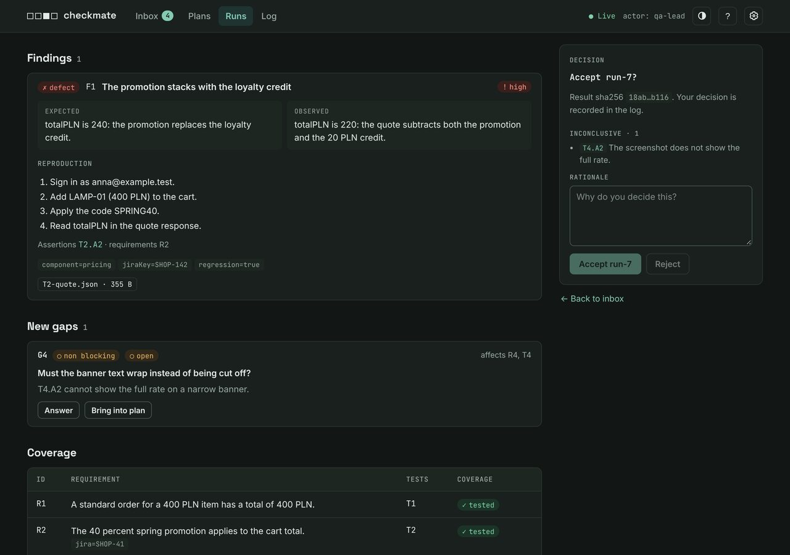
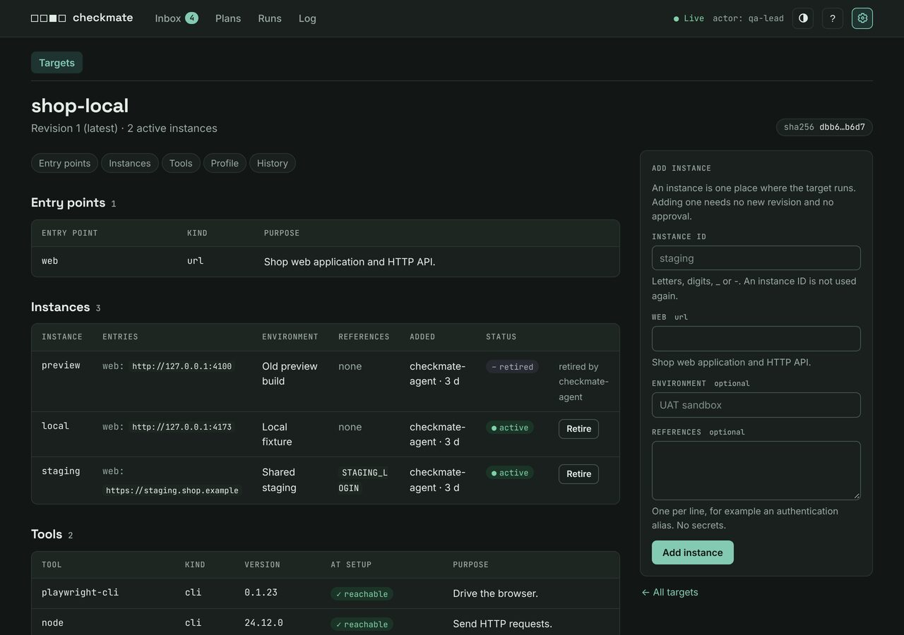

# Review in the browser

> **Guide** · For a human who makes the oracle's decisions in the review UI.

The review UI is a local web page on top of the same record. It shows what waits for you, and it lets you decide with the full context in front of you.

## Start the UI

In Claude Code:

```text
/checkmate:ui
```

With the npm CLI:

```sh
checkmate ui [--workspace <path>] [--port <n>]
```

The command prints `completed ui url=<url>`. Open that URL in a browser on the same computer. The UI listens on `127.0.0.1` only. It runs until you stop it with Ctrl+C. The plugin contains the UI, so you do not need npm.

## Pages

### Needs you

The start page. It shows the items that wait for your decision in a list on the left, and the selected item on the right. The most urgent item is first, and the page selects it when it opens. The list has these groups, in this order:

1. `Blocks testing`: the open questions and gaps that block testing.
2. `Claims to decide`: the claims that are `suspected` or `unresolved`, the most severe first.
3. `Approvals`: the plans to approve or change, and the results to accept.
4. `Questions that do not block`: the other open questions and gaps. This group is folded. Click its title to open it.

Above the groups, `Explorations` names each running, paused, or failed exploration, with a link to its live view. A paused exploration waits for you in the Claude Code session, not in the UI.

The number next to `Needs you` counts the items of the first three groups. The questions that do not block are not in the number.

- On a question, choose the kind of answer, write the answer and the rationale, then click `Record answer`.
- On a claim, read the expected and the actual result, the steps, and the evidence. Choose `Accept as a defect` or `Reject`, write the rationale, then click `Record decision`.
- On a plan or a result, click `Review and decide`. The plan page or the run page opens.

After you record an answer or a decision, the list selects the next item. The page does not load again. The address of the page keeps the selected item and the filters, for example `/?plan=checkout&q=coupon&item=...`. Thus Back in the browser and a copied link show the same list and item. The breadcrumb above the item goes back to the list. `Open full page` opens the claim, question, or gap page.

On a window narrower than 760 pixels, the list and the item take turns. Select an item to show it. Click `Needs you` in the breadcrumb to show the list again.

`/inbox` shows all items as one list, oldest first.

### Exploration

`/explorations/<explorationId>` is the live view of one exploration. It updates by itself while the exploration runs. It shows:

- The state of the exploration and, while it runs, its phase.
- One row for each explorer: the turn (`study`, `test`, or `follow-up`), the state, the start time, the elapsed time, and the last activity line when the record has one.
- The phases `record`, `merge`, `verify`, and `follow-up` with their states and reasons.
- `Not merged yet`: the raw questions and defects of single explorers. They can change before the exploration is completed. The inbox and the plan page do not show them.
- The merged claims and questions. They show when the exploration is completed.
- After the end, a link to each file that the record keeps for an explorer: `plan.md`, `questions.md`, `report.md`, and `follow-up-report.md`. The page shows the file from the record, not from the disk. A file of a follow-up shows its phase, for example `follow-1`.

A verify step that ends as `skipped` shows its reason. A failed or stopped exploration shows its reason and the kept work folder `.checkmate/work/<explorationId>` and the log. A failed follow-up does not change a completed exploration. The page shows the reason of the follow-up and its kept data, and the claims and questions stay.

A claim page shows the expected result, the actual result, the steps, the evidence, and the reporters. An image shows as a thumbnail. Click it to see it larger. A small text file shows as text. On it, you accept the claim as a defect or reject it, with a rationale. `Download report` gives the record as Markdown or JSON.

### Running explorations

`Needs you`, the inbox, the plan pages, the loop state, and the counts show only the merged claims and questions of completed explorations. While a follow-up runs, its new entries wait in the same way. The plan page names each running exploration in one banner: `Exploration <id> is running`, with a link to the live view.

### Plans


Each plan at its latest revision. A plan without a revision shows `no revision yet`, and its link opens its plan page. The `Loop` column shows the [loop state](../reference/commands.md#loop-states) and the role that it waits on. Filter with `Waits on`, sort by a column header, and type in the search field to filter. Lists show 25, 50, or 100 rows for each page. The URL keeps the list state.

### Plan


The tests, gaps, requirements and coverage, runs, decisions, and history of one revision. Approve or reject the revision in the panel. `Export` downloads the plan as HTML, Markdown, or JSON. Resolved and deferred gaps are folded below the open gaps.

The plan page also lists the explorations of the plan, and the merged claims and questions of the completed explorations. Each claim links to its decision form. Each open question links to its answer form.

A plan without a revision has a plan page from its first test. Open it from the plan list, the inbox, or an exploration. It shows the objective, the target, the instance, the sources, the explorations with their state, build, level, and start time, the claims, the questions, and the stored tests. When there are no stored tests, it tells you how to make them with `checkmate harvest <explorationId>`.

`Edit plan` opens the editor. It has forms for the requirements, tests, assertions, and coverage. `Edit as JSON` adds or removes items. Only the latest revision can change, and the rules of `plan edit` apply.

### Run



The outcomes, the assertions with evidence, the findings, the new gaps, the coverage, and the result decision. Each new gap that the plan does not have yet has `Answer` and `Bring into plan`. The decision panel lists each inconclusive assertion above the buttons. When the run is finished, `Download report` gives HTML, Markdown, JSON, or JUnit XML. The plan and run pages show the metadata of the requirements, tests, and findings as `key=value` tags.

### Runs and Log

The run list and the operation log. They page, sort, and filter like the plan list. The run list and the run page show the instance of each run.

### Settings



The button with the gear icon at the right of the top bar opens Settings. The first page is `Targets`. It lists each target with its latest revision, its capabilities, its entry points, and its number of active instances.

A target page shows the entry points, the instances, the tools, the profile with the authentication references, and the revision history. Open an older revision from the history.

- **Add instance.** Give an instance ID and a value for each entry point. The environment and the references are optional. Write one reference on each line. Adding an instance needs no new revision and no approval.
- **Retire.** Click `Retire` on the instance row, then `Confirm retire`. No new run can start on a retired instance. Its runs stay as they are.

Each change records your name and shows in the Log, as with the command `target instance add` or `target instance retire`.

## How a decision works

1. Type a rationale. The action button stays disabled until the rationale has text.
2. Click the action, for example `Approve checkout@2`. The panel shows a short summary and a `Confirm` button.
3. Click `Confirm`. The UI records the decision and opens `Needs you`.

Each form sends the digest of the snapshot that you see. A decision form also sends a token of the latest decision on the subject. When the record changed after the page loaded, the UI refuses the action, keeps your text, and shows a message.

- When another oracle decided after the page loaded, the message names the decision and the actor, for example `run-7 was accepted by qa-lead`. Your decision is not recorded. Read the decision, then send yours again.
- A form that you send a second time, for example after Back in the browser, is refused in the same way. The UI records each decision once.
- When the plan changed after you opened the editor, the editor shows the latest version. `Your changes (not saved)` lists the values from your form that differ from it. Apply them again, then save.
- A form with more than 256 KiB of text is refused with the status 413. Nothing is recorded.

## Your name

Each decision records an actor. The UI fills in the same default as the commands. The header shows `actor: <name>`. Click it to change the name. The UI keeps the new name in a cookie.

## Live updates

Each page updates when another process writes to the record, for example a delegated worker. The header shows `Live` while the connection is open. A form with your typed text is never replaced. Without JavaScript, the pages still work, and a reload shows the current state.

## Keyboard

| Key            | Action                                                                  |
| -------------- | ----------------------------------------------------------------------- |
| `/`            | Focus the search field.                                                 |
| `j` `k`        | Move down and up in a list. On `Needs you`, select the next item.       |
| `Enter`        | Open the selected item. On `Needs you`, go to the form of the item.     |
| `a` `r`        | On a claim in `Needs you`: choose `Accept as a defect` or `Reject`.     |
| `c` `s` `d`    | On a question in `Needs you`: choose Clarify, Accept assumption, Defer. |
| `Ctrl` `Enter` | Send the form of the item.                                              |
| `g` `i`        | Go to `Needs you`.                                                      |
| `Esc`          | Close the evidence viewer or menu.                                      |
| `?`            | Show the shortcuts.                                                     |

## Next

- [Decide as the oracle](oracle.md): what each decision does.
- [The record](../reference/record.md#review-ui): how the UI reads and protects the record.
