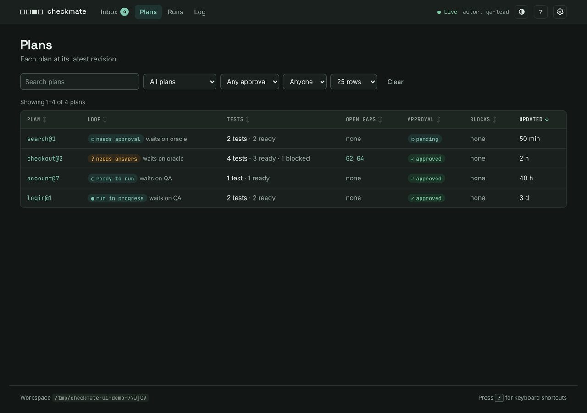
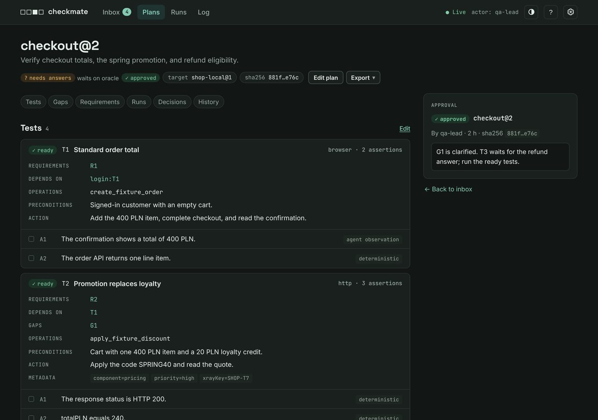

# Review in the browser

> **Guide** · For a human who makes the oracle's decisions in the review UI.

The review UI is a local web page on top of the same record. It shows what waits for you, and it lets you decide with the full context in front of you.

## Start the UI

In Claude Code:

```text
/checkmate:ui
```

With the npm CLI:

```sh
checkmate ui [--workspace <path>] [--port <n>]
```

The command prints `completed ui url=<url>`. Open that URL in a browser on the same computer. The UI listens on `127.0.0.1` only. It runs until you stop it with Ctrl+C. The plugin contains the UI, so you do not need npm.

## Pages

### Needs you

The start page. It shows the items that wait for your decision in a list on the left, and the selected item on the right. The most urgent item is first, and the page selects it when it opens. The list has these groups, in this order:

1. `Blocks testing`: the open questions and gaps that block testing.
2. `Claims to decide`: the claims that are `suspected` or `unresolved`, the most severe first.
3. `Approvals`: the plans to approve or change, and the results to accept.
4. `Questions that do not block`: the other open questions and gaps. This group is folded. Click its title to open it.

Above the groups, `Explorations` names each running, paused, or failed exploration, with a link to its live view. A paused exploration waits for you in the Claude Code session, not in the UI.

The number next to `Needs you` counts the items of the first three groups. The questions that do not block are not in the number.

- On a question, write the answer, then click `Record answer` or press `Ctrl` `Enter`. The kind of answer is `Clarify` by default. Click `Accept assumption` or `Defer` to change it. `Defer` needs no answer.
- `Add source and reason` opens two optional fields. When you leave them empty, the record names you and the review UI as the source, and states that no reason was given. Once you open the fields, they stay open until you close the browser tab.
- On a claim, read the expected and the actual result, the steps, and the evidence. Click `Accept as a defect`, or write a short reason and click `Reject`. A reject needs a reason. An accept does not.
- On a plan or a result, read the summary, write a rationale, choose the decision, then click `Confirm`. The plan page and the run page show the full record.

After you record an answer or a decision, the list selects the next item. The page does not load again. The address of the page keeps the selected item and the filters, for example `/?plan=checkout&q=coupon&item=...`. Thus Back in the browser and a copied link show the same list and item. The breadcrumb above the item goes back to the list. `Open full page` opens the claim, question, or gap page.

On a window narrower than 760 pixels, the list and the item take turns. Select an item to show it. Click `Needs you` in the breadcrumb to show the list again.

`/inbox` shows all items as one list, oldest first.

### Claims

`/claims` lists the claims of all plans, newest first, in the same layout as `Needs you`. Filter them by state, severity, plan, build, and the time when the exploration found them, for example `Last 7 days`. The search field looks in the title, the expected and the actual result, the build, and the exploration. The filters and the selected claim are in the address, so a link shows the same list.

The selected claim shows its steps and its evidence. A claim without a decision has the same decision form as in `Needs you`.

### Exploration

`/explorations/<explorationId>` is the live view of one exploration. It has the same layout as `Needs you`: a list on the left and the selected item on the right. It updates by itself while the exploration runs. The selected item, the scroll position, and your typed text stay.

The list shows:

- The state of the exploration, its plan, build, instance, and level. A paused exploration shows its reason. A failed or stopped exploration shows its reason, the kept work folder `.checkmate/work/<explorationId>`, and the log.
- `Overview`: the number of claims and questions, and the number of items that are not merged yet.
- `Explorers`: one row for each explorer, with its step or turn (`study`, `test`, or `follow-up`), its state (`given to the session`, `running`, `ended`, `completed`, `failed`, or `stopped`), the time in that state, and the last activity line.
- `Phases`: `record`, `merge`, `verify`, and `follow-up`, with their states and reasons. A verify step that ends as `skipped` shows its reason.

Select a row to show it on the right:

- `Overview` shows `Not merged yet`, the merged claims and questions, the saved files, and `Download report` (Markdown or JSON). The merged claims and questions show when the exploration is completed.
- An explorer shows its state, its record, the items that it found, and its saved files: `plan.md`, `questions.md`, `report.md`, and `follow-up-report.md`. A file of a follow-up shows its phase, for example `follow-1`. Each found item shows its evidence and says if it is merged, and into which claim or question.
- A phase shows its state and its reason.

`Not merged yet` items have a dashed border. They are the raw questions and defects of single explorers. They can change before the exploration is completed. `Needs you` and the plan page do not show them.

A failed follow-up does not change a completed exploration. The overview shows the reason of the follow-up and its kept data, and the claims and questions stay.

### Evidence

All pages show evidence in the same way:

- An image shows as a thumbnail. Click it to open the viewer. In the viewer, click the image or press `+`, `-`, `0` (fit), or `1` (actual size) to zoom.
- A small text file shows as text, with long lines wrapped. Click `View` to open it in the viewer. Press `w` in the viewer to wrap or not wrap the lines.
- Each file has `Download`. A large file or a file of another type shows only as a download.

Press `Esc` to close the viewer. The files of an explorer open in the same viewer.

A claim page shows the expected result, the actual result, the steps, the evidence, and the reporters. On it, you accept the claim as a defect or reject it, with a rationale. `Download report` gives the record as Markdown or JSON.

### Running explorations

`Needs you`, the inbox, the plan pages, the loop state, and the counts show only the merged claims and questions of completed explorations. While a follow-up runs, its new entries wait in the same way. The plan page names each running exploration in one banner: `Exploration <id> is running`, with a link to the live view.

### Plans



Each plan at its latest revision. A plan without a revision shows `no revision yet`, and its link opens its plan page. The `Loop` column shows the [loop state](../reference/commands.md#loop-states) and the role that it waits on. Filter with `Waits on`, sort by a column header, and type in the search field to filter. Lists show 25, 50, or 100 rows for each page. The URL keeps the list state.

### Plan



The plan page is the context of everything that belongs to the plan. Its header shows the approval, the loop state, the one next step, and the number of claims, questions, explorations, tests, and runs. When items of the plan wait for you, `Decide <n> items in Needs you` opens `Needs you` with the plan as filter.

The sections fold: `Overview`, `Claims`, `Questions`, `Explorations`, `Tests`, `Runs`, and `History`. A section opens by itself when it needs you: for example `Claims` when a claim waits for a decision, `Questions` when a question blocks testing, and `Runs` when a result waits for acceptance. The other sections are folded. Click a count in the header to open its section. A link to a gap, for example `#G2`, opens the section that holds it.

A claim in the plan opens in `Claims`. An open question opens in `Needs you`. Approve or reject the revision in the panel. `Export` downloads the plan as HTML, Markdown, or JSON.

A plan without a revision has the same page with the sections `Request`, `Claims`, `Questions`, `Explorations`, and `Stored tests`. When there are no stored tests, it tells you how to make them with `checkmate harvest <explorationId>`.

`Edit plan` opens the editor. It has forms for the requirements, tests, assertions, and coverage. `Edit as JSON` adds or removes items. Only the latest revision can change, and the rules of `plan edit` apply.

### Run


`/runs/<runId>` has the same layout as `Needs you`: a list on the left and the selected item on the right. The list shows the state of the run, its plan, build, and instance, and these rows:

- `Overview`: the outcome counts, the assertions that did not pass, and the result decision. The decision lists each inconclusive assertion above the buttons. When the run is finished, `Download report` gives HTML, Markdown, JSON, or JUnit XML.
- `Tests`: one row for each test, with its outcome. The test shows its assertions and their evidence.
- `Findings`: the defects and issues, with the expected and observed values, the reproduction steps, and the evidence.
- `New gaps`: each new gap that the plan does not have yet has `Answer` and `Bring into plan`.
- `Record`: the coverage, the cleanup, and the attempts.

A link to an assertion, for example `T2.A2`, selects its test. The plan and run pages show the metadata of the requirements, tests, and findings as `key=value` tags. The selected item is in the address, for example `/runs/run-7?item=test:T2`.

### Runs and Log

The run list and the operation log. They page, sort, and filter like the plan list. The run list and the run page show the instance of each run.

### Settings


The button with the gear icon at the right of the top bar opens Settings. The first page is `Targets`. It lists each target with its latest revision, its capabilities, its entry points, and its number of active instances.

A target page shows the entry points, the instances, the tools, the profile with the authentication references, and the revision history. Open an older revision from the history.

- **Add instance.** Give an instance ID and a value for each entry point. The environment and the references are optional. Write one reference on each line. Adding an instance needs no new revision and no approval.
- **Retire.** Click `Retire` on the instance row, then `Confirm retire`. No new run can start on a retired instance. Its runs stay as they are.

Each change records your name and shows in the Log, as with the command `target instance add` or `target instance retire`.

## How a decision works

1. Type a rationale. The action button stays disabled until the rationale has text.
2. Click the action, for example `Approve checkout@2`. The panel shows a short summary and a `Confirm` button.
3. Click `Confirm`. The UI records the decision and opens `Needs you`.

Each form sends the digest of the snapshot that you see. A decision form also sends a token of the latest decision on the subject. When the record changed after the page loaded, the UI refuses the action, keeps your text, and shows a message.

- When another oracle decided after the page loaded, the message names the decision and the actor, for example `run-7 was accepted by qa-lead`. Your decision is not recorded. Read the decision, then send yours again.
- A form that you send a second time, for example after Back in the browser, is refused in the same way. The UI records each decision once.
- When the plan changed after you opened the editor, the editor shows the latest version. `Your changes (not saved)` lists the values from your form that differ from it. Apply them again, then save.
- A form with more than 256 KiB of text is refused with the status 413. Nothing is recorded.

## Breadcrumb and Back

Each page below the top level shows a breadcrumb, for example `Plans › checkout@2 › G2`, and `← Back`. `← Back` goes to the page that you came from in the UI, with its list, filters, and selected item. When you opened the page from outside the UI, it goes to the parent in the breadcrumb.

## Your name

Each decision records an actor. The UI fills in the same default as the commands. The header shows `actor: <name>`. Click it to change the name. The UI keeps the new name in a cookie.

## Live updates

Each page updates when another process writes to the record, for example a delegated worker. The header shows `Live` while the connection is open. A form with your typed text is never replaced. Without JavaScript, the pages still work, and a reload shows the current state.

## Keyboard

| Key             | Action                                                                                                         |
| --------------- | -------------------------------------------------------------------------------------------------------------- |
| `/`             | Focus the search field.                                                                                        |
| `j` `k`         | Move down and up in a list. On `Needs you`, select the next item.                                              |
| `Enter`         | Open the selected item. On `Needs you`, go to the form of the item.                                            |
| `a`             | On a claim: accept it as a defect at once. On a plan or a result: approve or accept, then write the rationale. |
| `r`             | On a claim, a plan, or a result: reject. Write the reason, then press `Ctrl` `Enter`.                          |
| `c` `s`         | On a question: choose Clarify or Accept assumption, then write the answer.                                     |
| `d`             | On a question: defer it at once.                                                                               |
| `Ctrl` `Enter`  | Send the form of the item.                                                                                     |
| `g` `i`         | Go to `Needs you`.                                                                                             |
| `Esc`           | Close the evidence viewer or menu.                                                                             |
| `+` `-` `0` `w` | In the evidence viewer: zoom in, zoom out, fit the image, or wrap the lines of a text.                         |
| `?`             | Show the shortcuts.                                                                                            |

## Next

- [Decide as the oracle](oracle.md): what each decision does.
- [The record](../reference/record.md#review-ui): how the UI reads and protects the record.
