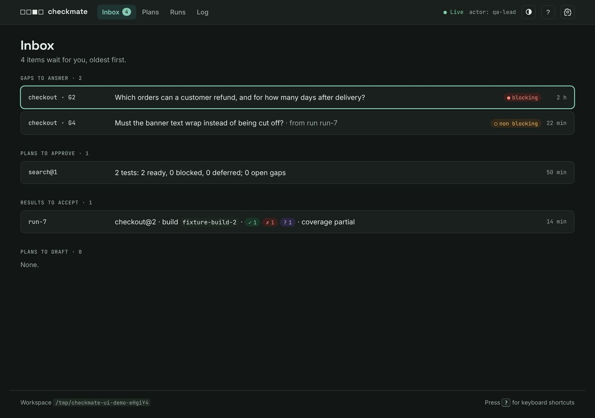
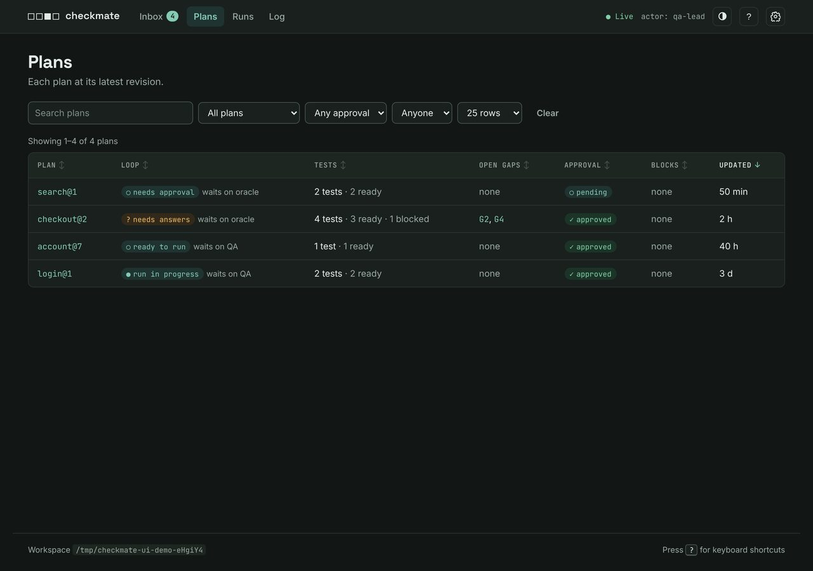
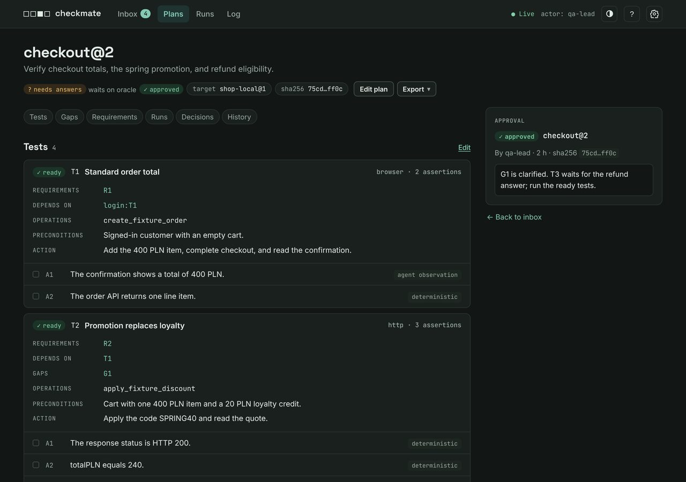
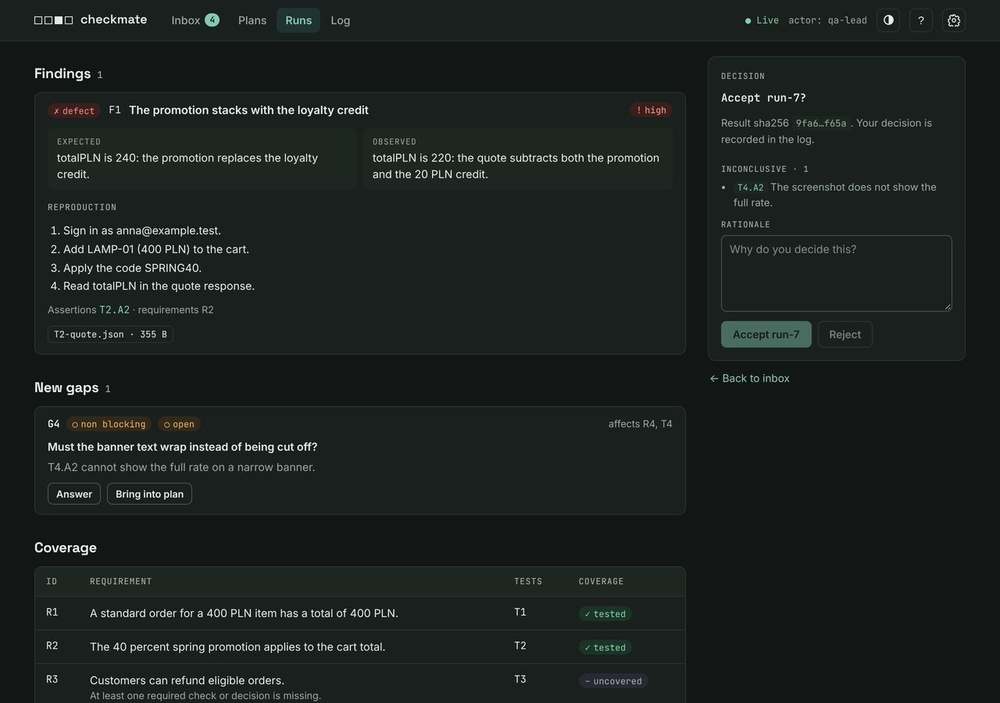

# Review in the browser

> **Guide** · For a human who makes the oracle's decisions in the review UI.

The review UI is a local web page on top of the same record. It shows what waits for you, and it lets you decide with the full context in front of you.

## Start the UI

In Claude Code:

```text
/checkmate:ui
```

With the npm CLI:

```sh
checkmate ui [--workspace <path>] [--port <n>]
```

The command prints `completed ui url=<url>`. Open that URL in a browser on the same computer. The UI listens on `127.0.0.1` only. It runs until you stop it with Ctrl+C. The plugin contains the UI, so you do not need npm.

## Pages

### Inbox



The start page. It groups the gaps to answer, the plans to approve, the results to accept, and the plans to draft. A gap from a run shows `from run <runId>`. After a decision, the UI opens the next item.

### Plans



Each plan at its latest revision. The `Loop` column shows the [loop state](../reference/commands.md#loop-states) and the role that it waits on. Filter with `Waits on`, sort by a column header, and type in the search field to filter. Lists show 25, 50, or 100 rows for each page. The URL keeps the list state.

### Plan



The tests, gaps, requirements and coverage, runs, decisions, and history of one revision. Approve or reject the revision in the panel. `Export` downloads the plan as HTML, Markdown, or JSON. Resolved and deferred gaps are folded below the open gaps.

`Edit plan` opens the editor. It has forms for the requirements, tests, assertions, and coverage. `Edit as JSON` adds or removes items. Only the latest revision can change, and the rules of `plan edit` apply.

### Run



The outcomes, the assertions with evidence, the findings, the new gaps, the coverage, and the result decision. Each new gap that the plan does not have yet has `Answer` and `Bring into plan`. The decision panel lists each inconclusive assertion above the buttons. When the run is finished, `Download report` gives HTML, Markdown, or JSON.

### Runs and Log

The run list and the operation log. They page, sort, and filter like the plan list.

## How a decision works

1. Type a rationale. The action button stays disabled until the rationale has text.
2. Click the action, for example `Approve checkout@2`. The panel shows a short summary and a `Confirm` button.
3. Click `Confirm`. The UI records the decision and opens the next inbox item.

Each form sends the digest of the snapshot that you see. When the record changed after the page loaded, the UI refuses the action, keeps your text, and shows a message.

## Your name

Each decision records an actor. The UI fills in the same default as the commands. The header shows `actor: <name>`. Click it to change the name. The UI keeps the new name in a cookie.

## Live updates

Each page updates when another process writes to the record, for example a delegated worker. The header shows `Live` while the connection is open. A form with your typed text is never replaced. Without JavaScript, the pages still work, and a reload shows the current state.

## Keyboard

| Key     | Action                             |
| ------- | ---------------------------------- |
| `/`     | Focus the search field.            |
| `j` `k` | Move down and up in a list.        |
| `Enter` | Open the selected item.            |
| `g` `i` | Go to the inbox.                   |
| `Esc`   | Close the evidence viewer or menu. |
| `?`     | Show the shortcuts.                |

## Next

- [Decide as the oracle](oracle.md): what each decision does.
- [The record](../reference/record.md#review-ui): how the UI reads and protects the record.
