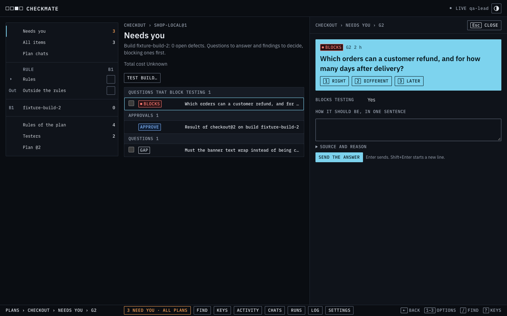
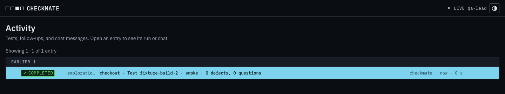

# Local QA with a human oracle

Use this path when a person makes the decisions and an installed host does the planning or test work. The person is the oracle. The host supplies the model and permissions. Checkmate stores the record and evidence.

[](media/ui/review.png)

## Before you start

- Install Node.js 24.12.0 or later and the Checkmate CLI. Follow [Start Checkmate](start.md).
- Start the application on a local URL that the workspace can reach.
- Configure Claude Code or Pi if Checkmate will delegate planning or QA. A person can make oracle decisions without a model.
- Install Playwright CLI only if the tests use a browser.

## Start a change

1. Change to the application workspace.
2. Start the review UI:

   ```sh
   checkmate ui
   ```

3. Open the printed URL.
4. If no target exists, enter the app URL in **Set up the application** and submit the form. The new-change form then opens.
5. Otherwise, choose **New change**.
6. Enter the ticket file or paste the ticket text.
7. Review the plan name, build ID, and test level.
8. Open Settings and choose a configured harness if the default is not correct.
9. Select **Start the test**.

The first-run form sets up the target and its local instance. Checkmate records the profile and test work in `.checkmate/checkmate.db`. It does not start the application.

If setup says the app is unreachable, start it or correct the URL, then submit the form again. If a source file is missing, add it to the workspace and retry. Do not continue with a guessed source or build.

## Answer a gap and continue

A test saves plan revision 1 when the plan has no revision. The rules of the sources become its requirements, each checked rule becomes a test, and each open question becomes a gap. Status then names the gaps that wait for you.

Run the inbox to find work that waits for the oracle:

```sh
checkmate inbox
```

Inspect the plan that waits for you:

```sh
checkmate status checkout
```

Replace `checkout` and `G1` with the IDs that Checkmate prints.

Read the `next` line in status. Answer a gap with the decision and its reason:

```sh
checkmate gap answer checkout G1 --kind clarify \
  --source ticket.md --value "The promotion replaces loyalty." \
  --rationale "Product owner decision."
```

The answer is pending. It does not change the plan. Ask the planner to apply it, then inspect the new revision:

```sh
checkmate delegate revise checkout --allow Read --allow Bash
checkmate status checkout
```

For Pi, set `CHECKMATE_HARNESS=pi` when you run the CLI and omit `--allow`. For Claude Code, give `--allow` rules for every required tool. The host enforces the permissions.

Approve only the latest revision that you reviewed:

```sh
checkmate plan approve checkout@2 --rationale "The tests match the ticket and answers."
```

Replace `checkout@2` with the latest revision. Status reports `needs_approval` until the required approval exists. If the target does not require plan approval, QA can run the ready tests without this step.

## Review a result and retry

Open the run and inspect its observations and evidence. If the record is correct, accept it, including when it reports a real defect:

```sh
checkmate run show run-1
checkmate result accept run-1 --rationale "The evidence matches the observed behavior."
```

Acceptance says that the record is correct. It does not say that the application passed. If the record is false or incomplete, reject it and explain what QA must change:

```sh
checkmate result reject run-1 --rationale "The evidence does not show the full checkout. Retest with a full-page capture."
checkmate status checkout
```

For a real defect, give its evidence to the factory. The factory fixes the application and supplies a distinct build. Start a new run with a new ID and the current plan revision:

```sh
checkmate run begin run-2 checkout@2 --build "$FIXED_BUILD" \
  --instance local --partial ready_only --retest-of run-1
checkmate delegate execute run-2 --allow Read --allow Bash
checkmate run show run-2
```

Replace the example plan revision and run IDs with the current values. The `run-1` commands above use the same IDs as this example. For Pi, omit `--allow`. The old run remains unchanged. Accept the new result only after you inspect its evidence and retest verdicts.

Activity lists tests, follow-ups, and chat messages. Open an entry to inspect its status.

A chat can read the plan and answer a gap or edit a plan without a prompt. It runs only the Checkmate commands for reading records and for the record writes that you ask for in the chat. Any other command, and any command that changes the application, waits for your permission. If nobody answers in about 10 minutes, Checkmate denies the command and the reply goes on without it.

[](media/ui/activity.png)

If a process stops, the run stays in the record. First read the reason and decide whether its actions are safe to continue. Then resume the same run:

```sh
checkmate run resume run-1
checkmate delegate execute run-1 --allow Read --allow Bash
```

`resume` rechecks the instance, profile, and run gate. It records a new attempt and lists the open tests. It does not run test actions. If you cannot safely continue a test, close it with a reason:

```sh
checkmate run close run-1 T2 --outcome error --reason "Could not resume safely."
```

See [CLI and record reference](reference.md#run-recovery).

Stop the review UI when you finish. The record stays in the workspace:

```sh
checkmate ui --stop
```
